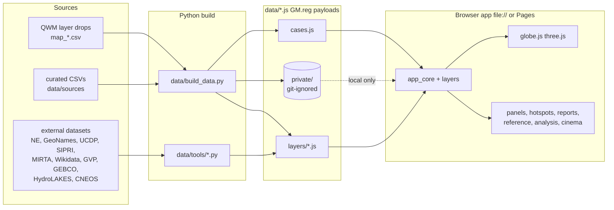

<div align="center">

# Global Map

**A cinematic 3D OSINT globe of sourced UAP and high-strangeness cases, set against military, nuclear, conflict,
water and sky layers. Every plotted row cites its source.**

[](https://github.com/0thernes/global-map-app/actions/workflows/ci.yml)
[](https://0thernes.github.io/global-map-app/)
[](https://github.com/0thernes/global-map-app/actions/workflows/codeql.yml)
[](https://github.com/0thernes/global-map-app/releases)
[](LICENSE)
[](DATA_LICENSE.md)
[](https://threejs.org)
[](#quick-start)
[](https://x.com/0thernes_ai)

**[Live demo](https://0thernes.github.io/global-map-app/)** · [User guide](docs/user-guide.md) · [Layer catalog](docs/layer-catalog.md) · [Audit](docs/audit/SUMMARY.md) · [Changelog](CHANGELOG.md)


</div>

## Why

UAP, abduction, mutilation and other high-strangeness reports are scattered across archives, databases and
testimony. Global Map puts them on one time-aware globe next to the things people usually ask about (military bases,
nuclear sites and tests, wars, oceans and lakes, fireballs) and lets you test the questions instead of guessing.
It is strict about evidence: **sourced rows only, no invented values, no coordinate jitter, every disagreement between
sources shown rather than hidden.**

## Features

|                          |                                                                                                                                                                                                                                                                                                                                                                             |
| ------------------------ | --------------------------------------------------------------------------------------------------------------------------------------------------------------------------------------------------------------------------------------------------------------------------------------------------------------------------------------------------------------------------- |
| **Cinematic globe**      | NASA day/night Blue/Black Marble blended by the real sun terminator, relief, specular ocean, atmosphere, bloom, optional film grain and chromatic aberration, HUD frame, optional EOX Sentinel‑2 2016 satellite basemap.                                                                                                                                                    |
| **ENGAGE and the tour**  | Boot screen with an ENGAGE button (unlocks audio, fullscreen, fly-in), then a 20-step guided tour that flies to the best-sourced cases, hotspots and findings. Muted until you interact.                                                                                                                                                                                    |
| **Timeline**             | 8000 BCE to today; day resolution since 1900; playback, date brushing, range bars for uncertain dates.                                                                                                                                                                                                                                                                      |
| **Cases**                | 2,593 public sourced rows (plus local-only private rows), graded CIT / Official record / ST / Testimony; pins only for exact or ≤ 1 km sites, uncertainty circles otherwise.                                                                                                                                                                                                |
| **Layers of layers**     | 30+ data layers in a tri-state tree (group › layer › sub-layer): military (MIRTA, Wikidata), reactors, nuclear sites and 2,057 tests, UCDP conflicts, volcanoes, faults, pyramids, megaliths, caves, ocean anomalies, **off-limits mountains**, **HydroLAKES**, **unmapped seafloor (GEBCO 2025)**, **oceanic trenches**, **CNEOS fireballs**, USO and satellite anomalies. |
| **Convergence hotspots** | Grid score of where many kinds of record meet, corrected for population, with an evidence grade A–F and a dossier per cluster.                                                                                                                                                                                                                                              |
| **Analysis**             | Distances to the nearest base / nuclear site / conflict event against uniform, population-weighted and date-permuted baselines; Monte Carlo p, bootstrap CIs, Bonferroni note; independently re-derived in Python.                                                                                                                                                          |
| **Reports**              | One-click dossier-style reports for the selection, a country, an era or a category; print to PDF or export standalone HTML.                                                                                                                                                                                                                                                 |
| **Reference**            | Sources, glossary, A–Z, sites, countries, coverage matrix (breadth × depth), off-world targets and credits.                                                                                                                                                                                                                                                                 |
| **OSINT tools**          | Search, filters (grade, precision, water distance, conflicts, `[verify]`), link graph, compare view, charts, lasso, exports (CSV, GeoJSON, Markdown), workspaces.                                                                                                                                                                                                           |

<table>
<tr><td></td><td></td></tr>
<tr><td></td><td></td></tr>
<tr><td></td><td></td></tr>
</table>

## Quick start

No install, no server.

1. Download the [latest release](https://github.com/0thernes/global-map-app/releases) zip, or clone the repo.
2. **Windows:** double-click `launch.cmd` (opens Chrome or Edge full-screen with the intro and sound).
   **Anywhere:** open `index.html` in a current Chrome, Edge or Firefox.
3. Press **ENGAGE**.

If your browser blocks scripts from `file://`, serve the folder: `python3 -m http.server 8080` and open
<http://localhost:8080>.

It is a static browser app (HTML, CSS, one JavaScript bundle and data files); it is not Electron and installs nothing.

### URL options

| Parameter             | Effect                                                       |
| --------------------- | ------------------------------------------------------------ |
| `?tour=intro`         | start the guided tour after boot                             |
| `?audio=on`           | start with sound on (still needs one click in most browsers) |
| `?fullscreen=1`       | ask for full screen on ENGAGE                                |
| `?intro=0`            | skip the boot screen                                         |
| `?fx=low` / `?perf=1` | fewer post effects / performance mode                        |
| `?basemap=s2`         | EOX Sentinel‑2 cloudless 2016 satellite basemap (online)     |
| `?private=0`          | do not try to load local-only private data                   |

## Keyboard

`/` search · `Space` play · `←/→` day (Shift month, Alt year) · `L` layers · `F` filters · `Z` hotspots · `E` reports ·
`I` index · `A` analyze · `V` charts · `G` graph · `C` compare · `W` wars · `B` briefings · `S` lasso · `H` heatmap ·
`T` tour · `M` mute · `,` settings · `R` random case · `Esc` close · `?` help

## Architecture



Details: [docs/architecture.md](docs/architecture.md) · [docs/data-pipeline.md](docs/data-pipeline.md).

## Data and grading

- **Sourced rows only.** No `source_url`, no plot. Rejected rows and the reason are in `data/unplotted_loader.csv`.
- **Grades:** CIT (Robert Hastings and Diana Pasulka count as CIT), Official record (archives), ST (experiencers),
  Testimony. Greer and Maussan rows are listed with zero weight. The audit only ever raises grades.
- **Precision:** pins for `exact_site` / `within_1km`; translucent circles for everything else. No jitter.
- **Conflicts** between sources are badged and both values are shown.
- **NUFORC** has no stated licence, so its rows stay in the git-ignored `data/private/` and load only on your machine.

Full rules: [docs/data-and-grading.md](docs/data-and-grading.md). Licences: [DATA_LICENSE.md](DATA_LICENSE.md),
[CREDITS.md](CREDITS.md).

## Audit

Ten forensic passes (sources, values, cross-dataset conflicts, grades, duplicates, reference layers, statistics,
glossary, code and security, UX) are in [docs/audit](docs/audit/SUMMARY.md). Every finding is classed as a bug, error,
issue, problem, dilemma or conflict ([TAXONOMY.md](docs/audit/TAXONOMY.md)) and listed in
[qwm-data-issues.csv](docs/audit/qwm-data-issues.csv).

## Development

```bash
npm ci
npm run build        # esbuild -> js/app.js
npm run check        # ESLint + Prettier + unit tests + data validation + build + headless smoke test
npm run package -- --zip   # reproducible release zip in dist/
```

Rebuild data (needs the raw downloads, see [data-pipeline.md](docs/data-pipeline.md)): `sh data/refresh.sh`.

## Roadmap

- [ ] OSM military extract (planet `military=*`) merged into the bases layer
- [ ] GHS-POP population grid for the population baseline
- [ ] HydroLAKES < 1 km² and HydroRIVERS as streamed vector tiles
- [ ] Streamed globe tiles (satellite and bathymetry beyond z3)
- [ ] UNHCR / IDMC displacement figures for the wars ranking
- [ ] More postal-code countries; admin-2 boundaries
- [ ] GPU picking and clustering beyond ~250k cases
- [ ] A decision on NUFORC licensing (see the audit dilemmas)

## Contributing

Data and code contributions are welcome. Read [CONTRIBUTING.md](CONTRIBUTING.md) and the
[Code of Conduct](CODE_OF_CONDUCT.md). Security reports: [SECURITY.md](SECURITY.md). Help: [SUPPORT.md](SUPPORT.md).

## Citation

If you use Global Map in research, cite it with [CITATION.cff](CITATION.cff) (GitHub shows a "Cite this repository"
button), and cite the underlying datasets listed in [CREDITS.md](CREDITS.md).

```
0thernes L.L.C. (2026). Global Map (Version 1.0.0) [Computer software]. https://github.com/0thernes/global-map-app
```

## Licence

Code: [MIT](LICENSE) © 2026 0thernes L.L.C. Data: each dataset keeps its own licence ([DATA_LICENSE.md](DATA_LICENSE.md)).

<sub>Made by [0thernes](https://0thernes.art) · [@0thernes_ai](https://x.com/0thernes_ai) · 0_0@0thernes.art</sub>
