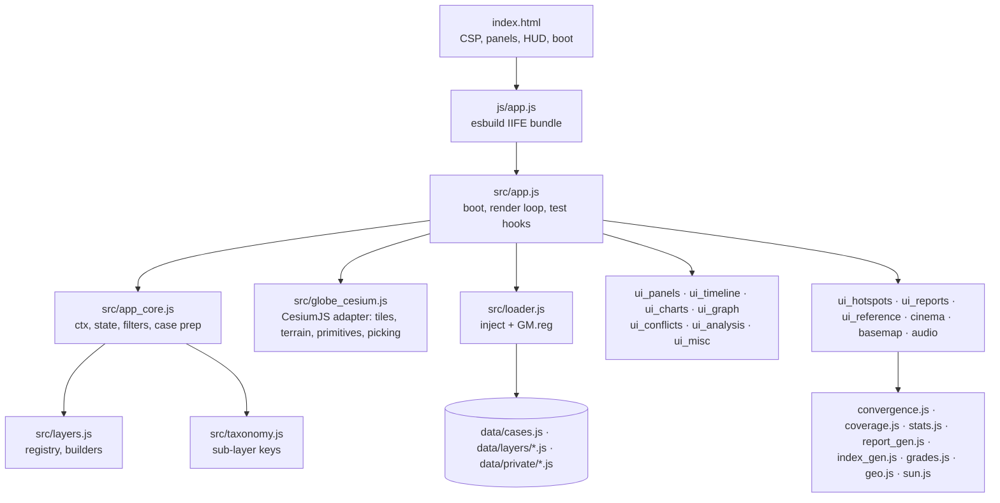

# Architecture

Global Map is a static web app. There is no server, and every record, layer and analysis is bundled, so the app works
offline. The online extras are optional and keyless: imagery and terrain tiles, and the USGS / NASA EONET live feeds. It must work from `file://`, so data files are JavaScript that register
themselves instead of JSON fetched with XHR.

## Loading

`src/loader.js` injects `<script src="data/…js">` tags; each file calls `GM.reg(name, payload)` (or sets a
`window.GM_*` global), which resolves the matching promise. This works over `file://`, GitHub Pages and any static
host. Large layers load lazily when switched on; HydroLAKES 1–10 km² and postal codes load per tile/country when you
zoom in. Optional private files (`data/private/`) are tried last; their absence is expected.

## Rendering

Since v1.1 the globe is **CesiumJS** (decision record: [adr/0001-cesium-renderer.md](adr/0001-cesium-renderer.md)).
`src/globe_cesium.js` is an adapter with the same API as the old three.js `Globe`:

- `src/cesium/C.js` lists the engine classes used (tree-shaken from `@cesium/engine` / `@cesium/core`).
- `src/cesium/sources.js` is the keyless imagery and terrain catalogue; `src/basemap.js` switches and persists it.
- `src/cesium/terrarium.js` turns AWS Terrain Tiles (terrarium PNG) into a `CustomHeightmapTerrainProvider`.
- `src/cesium/icons.js` draws the marker shapes as data URLs: glow, pin, the imprecise-row diamond, glitch, and
  (v1.5) six grade-gauge pins, plus cluster badges.
- `src/cesium/reference.js` (v1.5, [ADR 0005](adr/0005-globe-visual-system.md)) draws the latitude/longitude grid
  and the terminator with its twilight rings as batched GL_LINES primitives, from the pure geometry in
  `src/cesium/graticule.js`. It rebuilds on a key change only. `src/cesium/flight.js` plans each fly-to: duration,
  easing and apex height.
- Point layers are `BillboardCollection`s whose alpha/scale are recomputed on the CPU only when time, filters or
  playback mode change. Uncertainty circles are a batched ellipse fill plus a dashed
  GL_LINES edge (v1.5) at real radii in metres, with per-instance `show`. Line layers are one GL_LINES primitive each.
- `src/labels_cesium.js` places labels and cluster badges as world-anchored primitives; level of detail and greedy
  collision avoidance only choose which labels are visible.
- Lighting uses the sun at the timeline date and UTC hour (`clock.currentTime`), with NASA Black Marble night lights,
  sky and ground atmosphere, and fog. A custom post-process stage adds glow, grain, chromatic aberration and
  vignette, plus FXAA.
- DPR is capped at 2 and tracked with a `matchMedia` watcher. Picking projects candidates with
  `SceneTransforms.worldToWindowCoordinates` and checks horizon visibility.
- `src/live_feeds.js` fetches the keyless live layers (USGS earthquakes, NASA EONET).

## State and filters

`src/app_core.js` holds a single `ctx` (layers, globe, cases, hooks) and `st` (filters, selection, pins). Every view
(globe, charts, graph, reports, hotspots, analysis, exports) reads the same filtered set through `caseVisibleF`, so
they never disagree.

## Pure modules (unit-tested)

| Module                                                             | Job                                                                                      |
| ------------------------------------------------------------------ | ---------------------------------------------------------------------------------------- |
| `stats.js`                                                         | haversine, spatial index, medians, bootstrap, Wilson, Monte Carlo baselines, DBSCAN, KDE |
| `convergence.js`                                                   | hotspot grid score, clusters and evidence grade                                          |
| `coverage.js`                                                      | breadth/depth measures and the layers-of-layers coverage tree                            |
| `report_gen.js` · `index_gen.js`                                   | report and reference content                                                             |
| `grades.js` · `taxonomy.js` · `geo.js` · `sun.js`                  | grade classes, sub-layer keys, geodesy, solar position                                   |
| `cesium/graticule.js` · `cesium/flight.js`                         | grid lines and labels, small circles, terminator and twilight rings, fly-to planning     |
| `ui/symbology.js` · `ui/states.js`                                 | category colours and icons, pin vs circle, grade gauge; loading / empty / error markup   |
| `ui/breakpoints.js` · `ui/shortcuts.js`                            | the one breakpoint list (checked against the CSS); the one keyboard registry             |
| `text.js` · `data_clean.js` · `ui/workspace.js` · `ui/sanitize.js` | search folding and CSV; placeholder cleaning; workspace validation; HTML sanitiser       |

Tests: `test/unit/*.test.mjs` (Node test runner). Headless end-to-end: `test/smoke.mjs` (Playwright, SwiftShader).
The statistics are re-derived independently in Python by `scripts/audit/stats_crosscheck.py`.

## Cinema layer

`src/cinema.js` adds the boot screen, ENGAGE, the guided tour, the HUD frame, lower thirds, typed text, settings
(stored in `localStorage` key `gm.cine`) and URL parameters. `src/audio.js` mixes music, drone and UI effects with
Web Audio; everything starts muted until a user gesture. `src/basemap.js` fetches 64 EOX 2016 tiles (z3), reprojects
them to equirectangular on a canvas, and swaps the day texture.

## Security

A strict Content-Security-Policy meta tag in `index.html` allows only same-origin and `file:` scripts (plus
`'wasm-unsafe-eval'` for Cesium's WebAssembly), no inline scripts and no form actions. Images and `fetch` are limited
to the keyless tile and feed hosts listed in `src/cesium/sources.js` and `src/live_feeds.js`; hardening pass C01 checks
that the CSP and the code agree. Record text is escaped before it reaches `innerHTML`; Markdown from briefings is
rendered with `marked` and cleaned by `src/ui/sanitize.js`. CSV exports are RFC 4180 with a formula-injection guard
(`src/text.js`). See [SECURITY.md](../SECURITY.md) and [audit pass 9](audit/pass-09.md).

## Module index

Every file under `src/` and its job. Hardening pass K08 fails when a file is missing from this list.

| File                                                                                 | Job                                                                                   |
| ------------------------------------------------------------------------------------ | ------------------------------------------------------------------------------------- |
| `app.js`                                                                             | boot, render loop, boot-failure overlay, test hooks                                   |
| `app_core.js`                                                                        | shared `ctx` and `st`, filters, case preparation, exports helpers                     |
| `loader.js` · `cases_codec.js`                                                       | script-tag data loader (`GM.reg`); columnar case-table decoder                        |
| `layers.js` · `data_clean.js`                                                        | layer registry and builders; load-time removal of Wikidata unknown-value placeholders |
| `taxonomy.js` · `grades.js` · `glossary.js`                                          | sub-layer keys and the military-in-analysis rule; grade classes; glossary             |
| `text.js`                                                                            | accent folding for search, RFC 4180 CSV with the formula-injection guard              |
| `stats.js` · `convergence.js` · `coverage.js` · `pdf7_stats.js`                      | statistics, hotspot scoring, coverage, Data-panel tests                               |
| `geo.js` · `sun.js`                                                                  | geodesy and the segmented time scale; solar position                                  |
| `report_gen.js` · `index_gen.js`                                                     | report and reference content                                                          |
| `globe_cesium.js` · `labels_cesium.js` · `cesium/*`                                  | Cesium adapter, labels, imagery/terrain sources, icons, grid, fly-to                  |
| `basemap.js` · `live_feeds.js` · `audio.js` · `cinema.js` · `icons.js`               | basemap switch; live feeds; audio; cinema layer; Lucide icons                         |
| `ui_panels.js`                                                                       | top bar, left rail, dossier, exports, workspace                                       |
| `ui_timeline.js` · `ui_charts.js` · `ui_graph.js`                                    | timeline; linked charts; entity graph                                                 |
| `ui_analysis.js` · `ui_hotspots.js` · `ui_conflicts.js`                              | hypothesis analysis; convergence hotspots; wars and genocides                         |
| `ui_reports.js` · `ui_reference.js` · `ui_data.js` · `ui_misc.js`                    | reports; reference apparatus; Data panel; keyboard, help, compare, lasso              |
| `ui/window.js` · `ui/tabs.js` · `ui/table.js` · `ui/tips.js`                         | window manager; tabs; numeric columns; tooltips                                       |
| `ui/console.js` · `ui/clock.js` · `ui/feed.js` · `ui/timescale.js` · `ui/cluster.js` | console chrome; clocks; activity feed; timeline focus; cluster badges                 |
| `ui/symbology.js` · `ui/states.js` · `ui/breakpoints.js` · `ui/shortcuts.js`         | symbols and uncertainty radii; UI states; breakpoints; shortcuts                      |
| `ui/globe_tools.js` · `ui/workspace.js` · `ui/sanitize.js`                           | grid, terminator and heatmap toggles; workspace import checks; HTML sanitiser         |

## Build and release

`scripts/build.mjs` bundles `src/` to `js/app.js` (IIFE, no code splitting, so it runs from `file://`).
`scripts/package.mjs --site` builds the GitHub Pages folder and `--zip` a reproducible release zip.
Workflows: `ci.yml` (lint, unit and Python tests, ruff, data validation, build, smoke), `pages.yml`, `release.yml` (on `v*` tags), `codeql.yml`.
