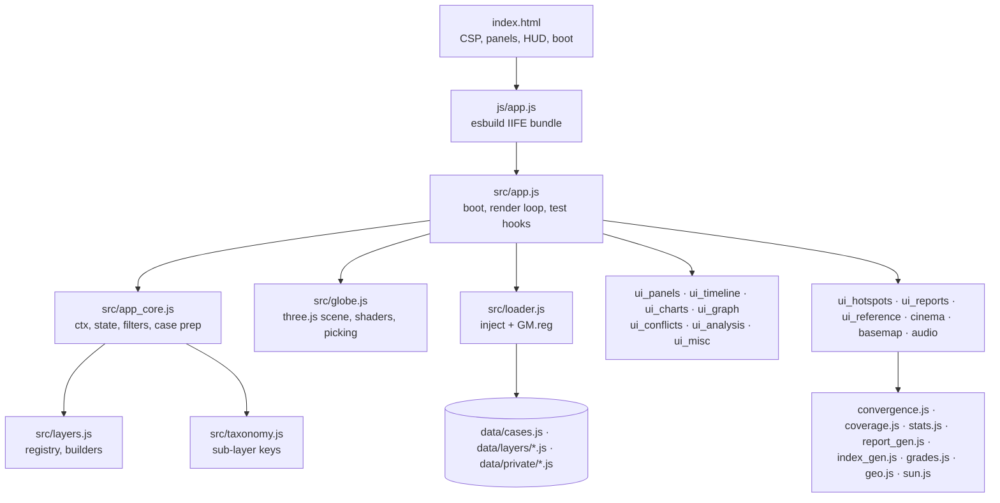

# Architecture

Global Map is a static web app. There is no server and no runtime dependency on the network (the optional satellite
basemap is the one online feature). It must work from `file://`, so data files are JavaScript that register
themselves instead of JSON fetched with XHR.

## Loading

`src/loader.js` injects `<script src="data/…js">` tags; each file calls `GM.reg(name, payload)` (or sets a
`window.GM_*` global), which resolves the matching promise. This works over `file://`, GitHub Pages and any static
host. Large layers load lazily when switched on; HydroLAKES 1–10 km² and postal codes load per tile/country when you
zoom in. Optional private files (`data/private/`) are tried last; their absence is expected.

## Rendering

`src/globe.js` owns the three.js r170 scene: a custom day/night shader (sun position from `src/sun.js` for the timeline
date and UTC hour), bump and specular maps, atmosphere, starfield, instanced point layers with a shape atlas
(pin, circle, diamond, glitch), uncertainty circles, line layers with level-of-detail swaps, a texture overlay (GEBCO
unmapped seafloor), arcs, and post-processing (bloom, grain, chromatic aberration, vignette) through EffectComposer.
DPR is capped at 2. Picking is CPU-side on a spatial index.

## State and filters

`src/app_core.js` holds a single `ctx` (layers, globe, cases, hooks) and `st` (filters, selection, pins). Every view
(globe, charts, graph, reports, hotspots, analysis, exports) reads the same filtered set through `caseVisibleF`, so
they never disagree.

## Pure modules (unit-tested)

| Module                                            | Job                                                                                      |
| ------------------------------------------------- | ---------------------------------------------------------------------------------------- |
| `stats.js`                                        | haversine, spatial index, medians, bootstrap, Wilson, Monte Carlo baselines, DBSCAN, KDE |
| `convergence.js`                                  | hotspot grid score, clusters and evidence grade                                          |
| `coverage.js`                                     | breadth/depth measures and the layers-of-layers coverage tree                            |
| `report_gen.js` · `index_gen.js`                  | report and reference content                                                             |
| `grades.js` · `taxonomy.js` · `geo.js` · `sun.js` | grade classes, sub-layer keys, geodesy, solar position                                   |

Tests: `test/unit/*.test.mjs` (Node test runner). Headless end-to-end: `test/smoke.mjs` (Playwright, SwiftShader).
The statistics are re-derived independently in Python by `scripts/audit/stats_crosscheck.py`.

## Cinema layer

`src/cinema.js` adds the boot screen, ENGAGE, the guided tour, the HUD frame, lower thirds, typed text, settings
(stored in `localStorage` key `gm.cine`) and URL parameters. `src/audio.js` mixes music, drone and UI effects with
Web Audio; everything starts muted until a user gesture. `src/basemap.js` fetches 64 EOX 2016 tiles (z3), reprojects
them to equirectangular on a canvas, and swaps the day texture.

## Security

A strict Content-Security-Policy meta tag allows only same-origin and `file:` scripts, no inline scripts, images from
`data:`/`blob:` and `tiles.maps.eox.at`, and no form actions. All record text is escaped before it reaches
`innerHTML`; Markdown from briefings is rendered with `marked` and sanitised. See [SECURITY.md](../SECURITY.md) and
[audit pass 9](audit/pass-09.md).

## Build and release

`scripts/build.mjs` bundles `src/` to `js/app.js` (IIFE, no code splitting, so it runs from `file://`).
`scripts/package.mjs --site` builds the GitHub Pages folder and `--zip` a reproducible release zip.
Workflows: `ci.yml` (lint, tests, data validation, build, smoke), `pages.yml`, `release.yml` (on `v*` tags), `codeql.yml`.
