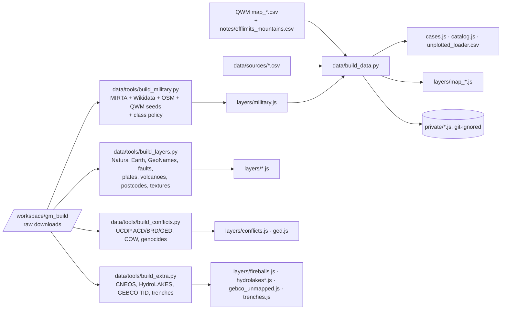

# Data pipeline



## One command

```bash
sh data/refresh.sh          # military merge (if raw data present) + build_data.py
python3 scripts/validate_data.py   # schema, sources, NUFORC absence, file sizes
node scripts/coverage.mjs          # docs/audit/coverage.md
python3 scripts/layer_catalog.py   # docs/layer-catalog.md
npm run build
```

`GM_MAP_DIR` points at the QWM drop folder (default `/workspace/qwm/wiw/data/map`, falling back to the snapshot in
`data/sources/qwm/`). The off-limits mountains file is read from `/workspace/qwm/wiw/notes/` when present, else from
the snapshot `data/sources/offlimits_mountains.csv` (never both).

## What build_data.py does

1. Reads every CSV, classifies it (case layer, reference layer, registry, languages).
2. Rejects rows without valid coordinates, a name, an `http(s)` `source_url`, or (cases) a parseable date. Reasons go
   to `data/unplotted_loader.csv`.
3. Normalises dates (ISO, BCE, decades → ranges), precision (`exact_site`, `within_1km`, `locality`, `region`,
   else `unspecified`) and radii; collapses duplicated composite grades (`X / X`).
4. Adds country, urban/rural, distance to shore and an over-water flag (Natural Earth, shapely).
5. Off-limits mountains: computes `nearest_military_site_km` (haversine, R = 6371 km) to the nearest site in
   `layers/military.js`, excluding forts, historic fortifications and gendarmerie barracks; records the site name,
   source and method; keeps QWM's `nearest_nuclear_site_km` as published.
6. Supersedes local curated rows that QWM now publishes; links the same event across datasets (`same_as`) and records
   every differing field as a conflict.
7. Splits private datasets (no redistribution licence) into `data/private/`, moving any public-row link that points at
   a private record into `data/private/private_links.js`.
8. Writes `cases.js` (slim rows + `case_details/` when large), `layers/map_*.js`, `catalog.js` and copies the QWM
   briefings.

## Military class policy

The Wikidata query walks `P31/P279*` from *military base*, *installation*, *air base*, *naval base* and *fort*. That
walk also reaches fire lookout towers, belfries, bird hides and medieval towers. `data/tools/military_class_policy.json`
lists 115 direct classes: an item whose every class is *drop* is removed (2,624 items); one whose classes are all
historic is labelled a fort/historic fortification (9,149); gendarmerie, Guardia Civil and Carabinieri barracks are
labelled as such (3,688). Historic and gendarmerie rows stay visible but are excluded from the analysis and hotspots.
Refresh the class map with the queries described in `data/tools/build_military.py`.

## External snapshots kept in the repo

| File | Source |
|---|---|
| `data/sources/external/cneos_fireball.json` | NASA JPL SSD fireball API |
| `data/sources/external/wikidata_trenches.json`, `wikidata_deeps.json` | Wikidata SPARQL and entity data (CC0) |
| `data/sources/qwm/*.csv.gz` | QWM public layer snapshot |

Large rasters and shapefiles (GEBCO TID GeoTIFF, HydroLAKES shapefile, NASA textures source) are not committed; the
derived, downsampled outputs are.
