# v1.5 wireframes (low fidelity)

These wireframes are generated by `node scripts/design/wireframes_v15.mjs` from the same layout numbers as
`css/tokens.css` and `css/console.css`. Each box is a layout region drawn at its real pixel size. The text inside
the boxes is annotation, not data. The decision records are
[ADR 0004](../../adr/0004-osint-console-information-architecture.md) (console information architecture) and
[ADR 0005](../../adr/0005-globe-visual-system.md) (globe visual system, reference overlays, panel states). The v1.4
set is archived in [v1.4/](v1.4/README.md).

| Viewport  | State                                                  | SVG                            | PNG                          |
| --------- | ------------------------------------------------------ | ------------------------------ | ---------------------------- |
| 1280x800  | main: rail, legend, timeline                           | [svg](1280x800_main.svg)       | 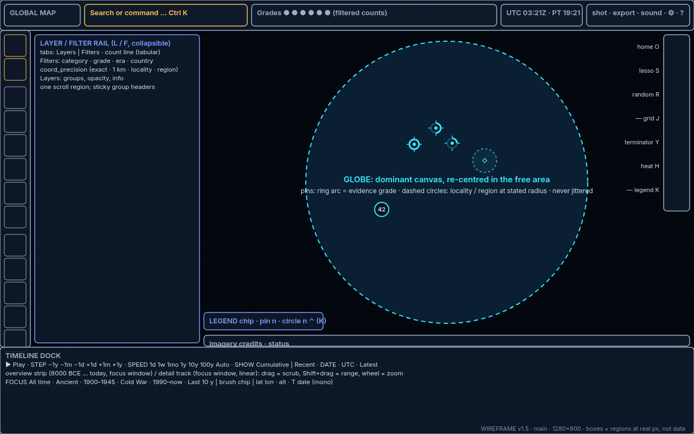       |
| 1280x800  | dossier, with the rail collapsed                       | [svg](1280x800_dossier.svg)    | 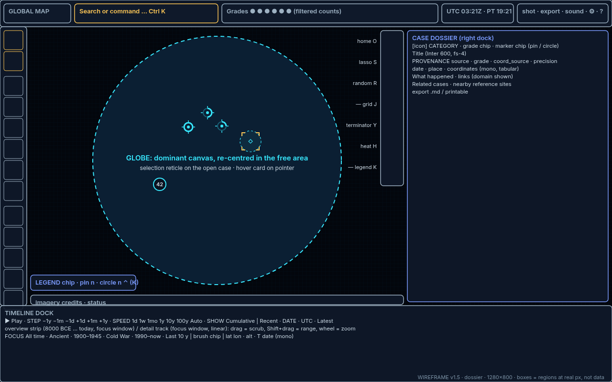    |
| 1280x800  | globe reference: grid (J), terminator and twilight (Y) | [svg](1280x800_reference.svg)  | 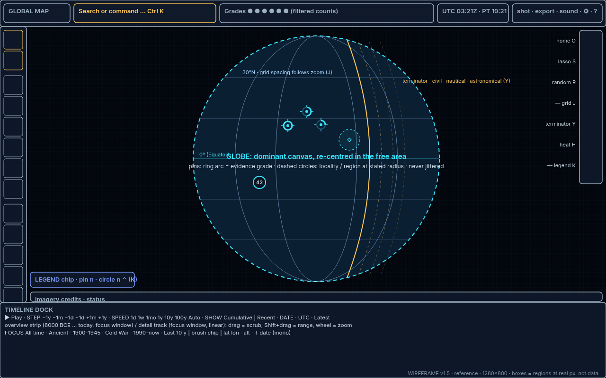  |
| 1920x1080 | main                                                   | [svg](1920x1080_main.svg)      | 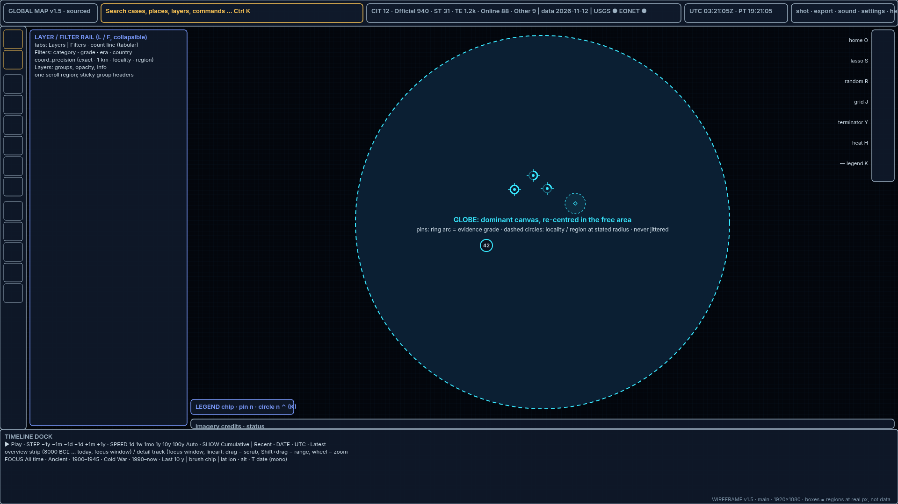      |
| 1920x1080 | dossier, hover card and selection reticle              | [svg](1920x1080_dossier.svg)   | 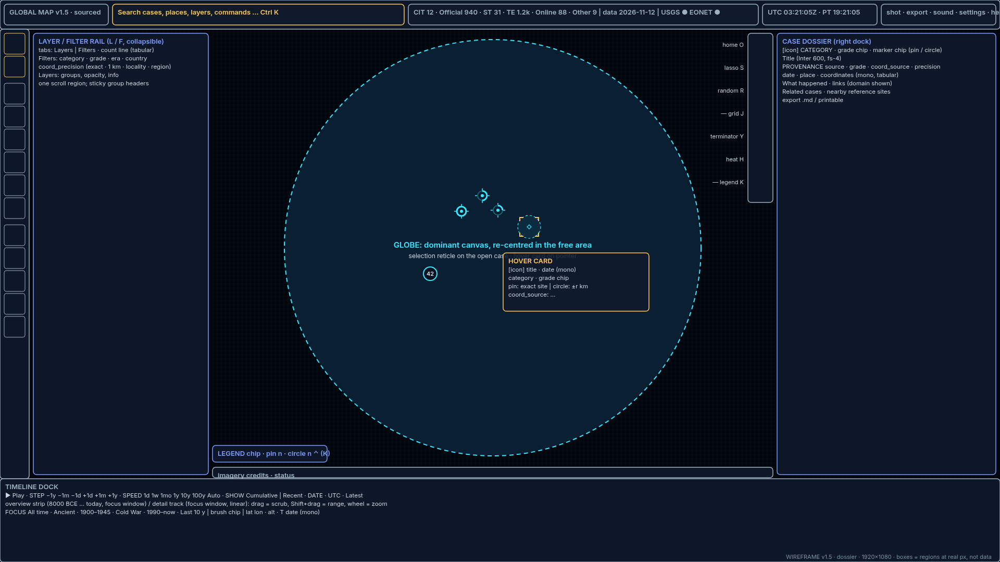   |
| 1920x1080 | globe reference with the rail open                     | [svg](1920x1080_reference.svg) | 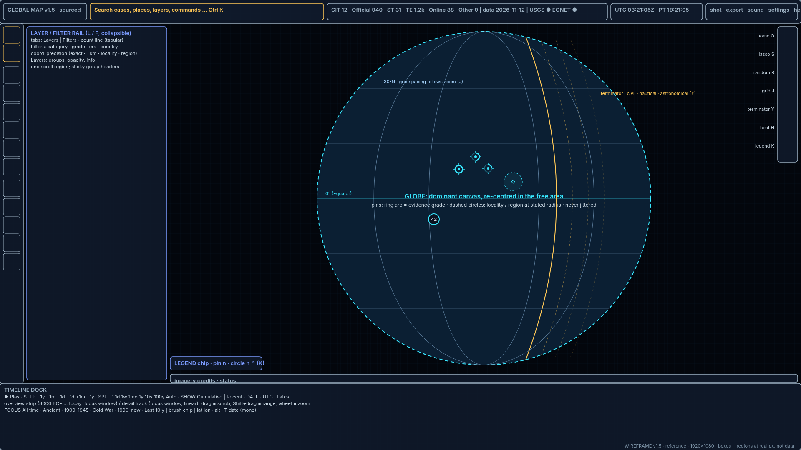 |
| 1920x1080 | panel states: loading, empty, error (feed shown)       | [svg](1920x1080_states.svg)    | 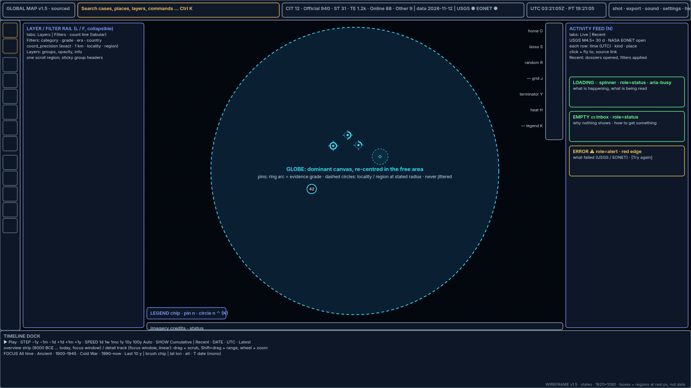    |
| 1920x1080 | command palette (Ctrl+K) over the console              | [svg](1920x1080_palette.svg)   | 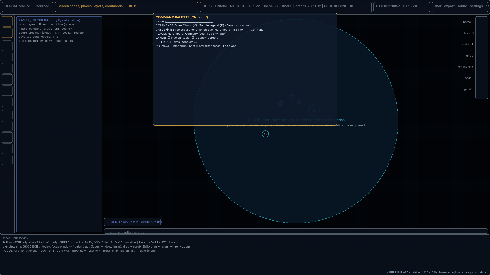   |
| 1920x1080 | analysis: activity feed and a bottom dock              | [svg](1920x1080_analysis.svg)  | 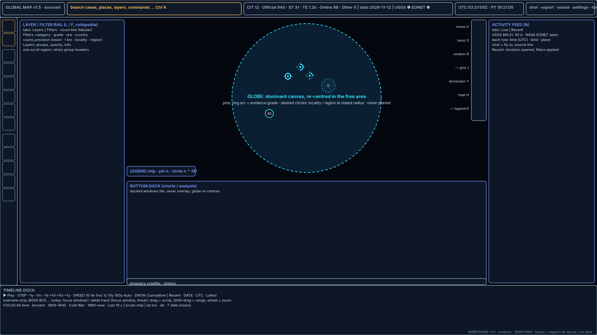  |
| 3840x2160 | main, at the 1.25x ladder                              | [svg](3840x2160_main.svg)      | 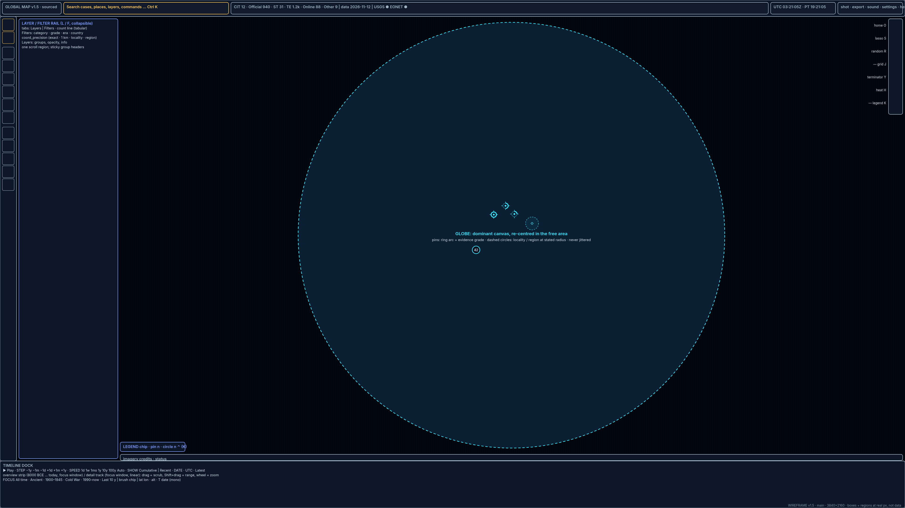      |
| 3840x2160 | globe reference with the dossier open                  | [svg](3840x2160_reference.svg) | 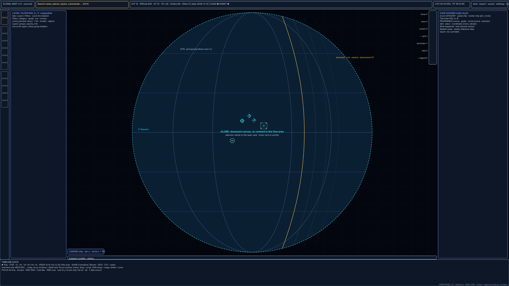 |
| 3840x2160 | dossier, feed and hover card                           | [svg](3840x2160_dossier.svg)   | 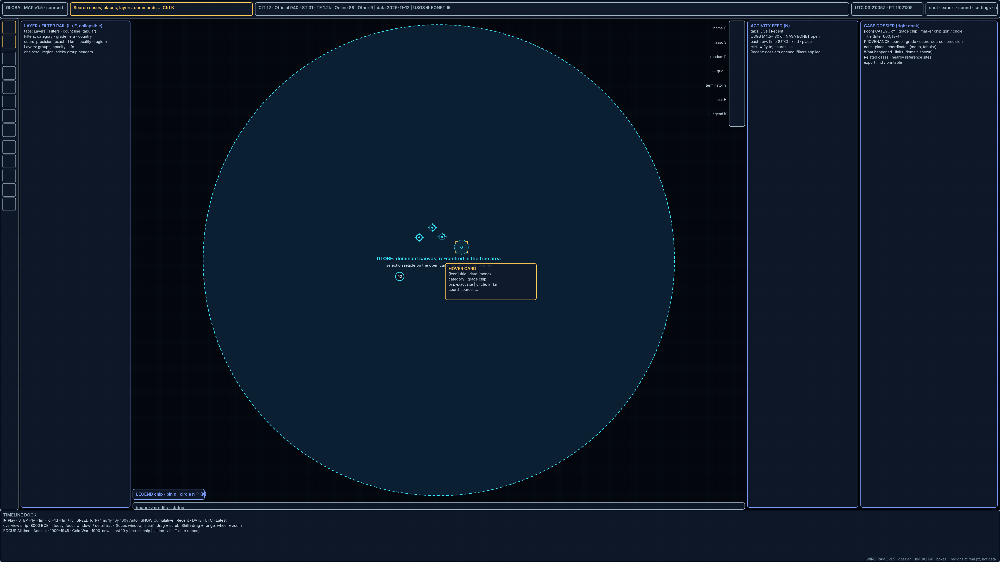   |

## What changed from v1.4

- **Map tools, 7 targets:** home, lasso and random; a separator; grid (J), terminator (Y) and heatmap (H); a
  separator; legend (K). Each target is 40 px on a 44 px pitch. Pressed toggles are drawn in the accent colour.
- **Marker grammar:** a pin is a ring gauge. Its bright arc shows the weight of the evidence grade (full for CIT and
  official records, three quarters for ST, half for testimony, a quarter for online claims and ungraded rows), and CIT
  adds a halo. A locality or region row is a dashed circle at its stated radius with a hollow diamond at the centre.
  Nothing is jittered, and `coord_source` stays in the hover card and the dossier.
- **Globe reference layer:** the latitude/longitude grid adapts from 30° in orbit to 0.25° at street level, with labels
  along the parallel and meridian nearest the view centre. The terminator is solid amber, and the civil, nautical
  and astronomical twilight rings are dashed and fade with depth.
- **Panel states:** loading, empty and error look the same in every panel. Each one says what is happening, why, and
  what to do next, and the error state has one recovery button.

## Region rules (unchanged from v1.4)

- **Command bar, 56 px:** brand, omnibox, grade status strip, UTC and PT clocks, utilities.
- **Activity bar, 56 px:** 13 views in three groups.
- **Rail:** 304 px below 1440 px wide, 336 px above, 420 px at 4K. It collapses into the activity bar.
- **Right docks:** the dossier, 420 px, and the feed, 340 px. They tile inwards and never overlap.
- **Bottom dock:** charts and analysis, spanning the space between the side docks.
- **Legend:** bottom left of the free globe area. It moves above any bottom dock.
- **Timeline dock, 160 px:** the transport row, the overview strip and detail track, and the focus row.
- **4K at DPR 1:** every size above is multiplied by 1.25.
