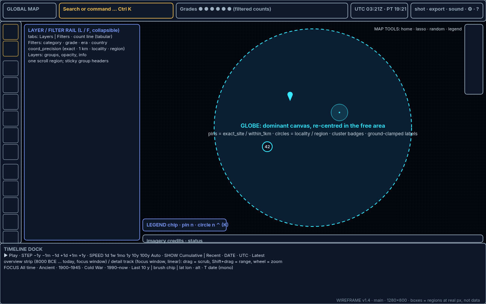
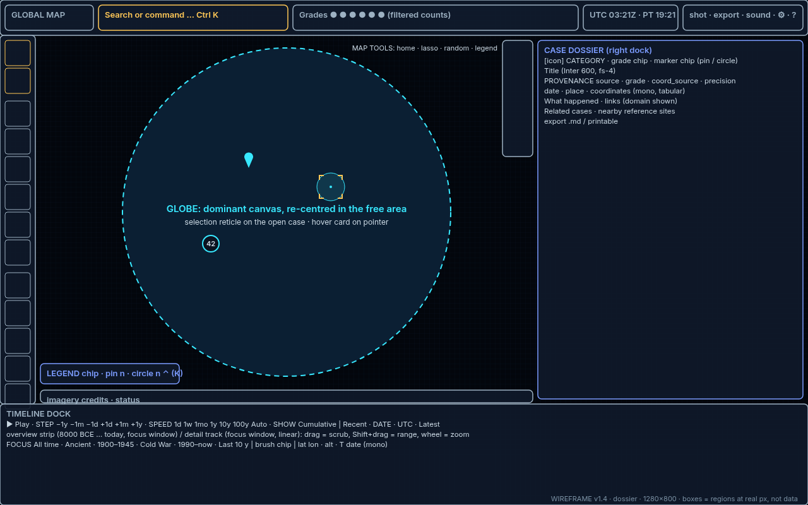
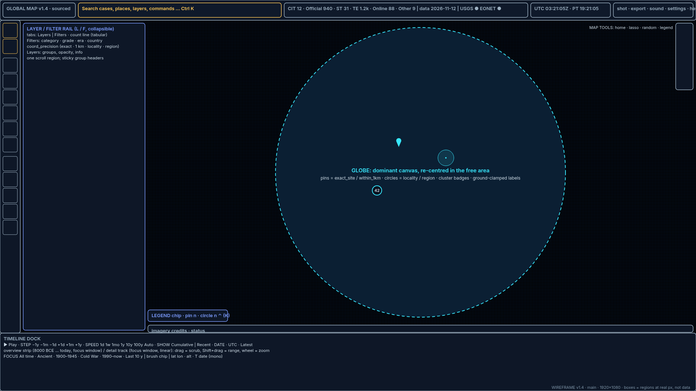
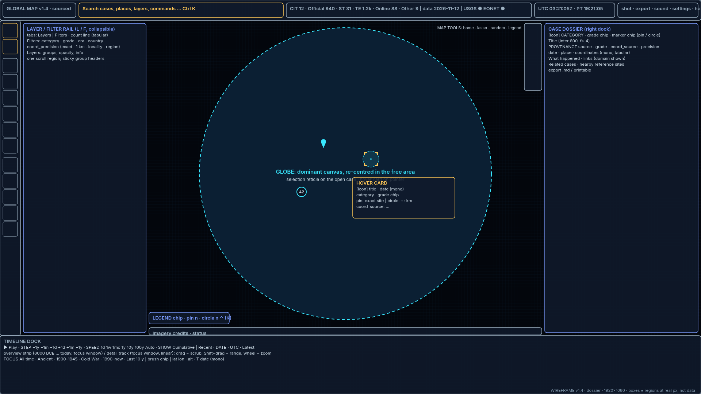
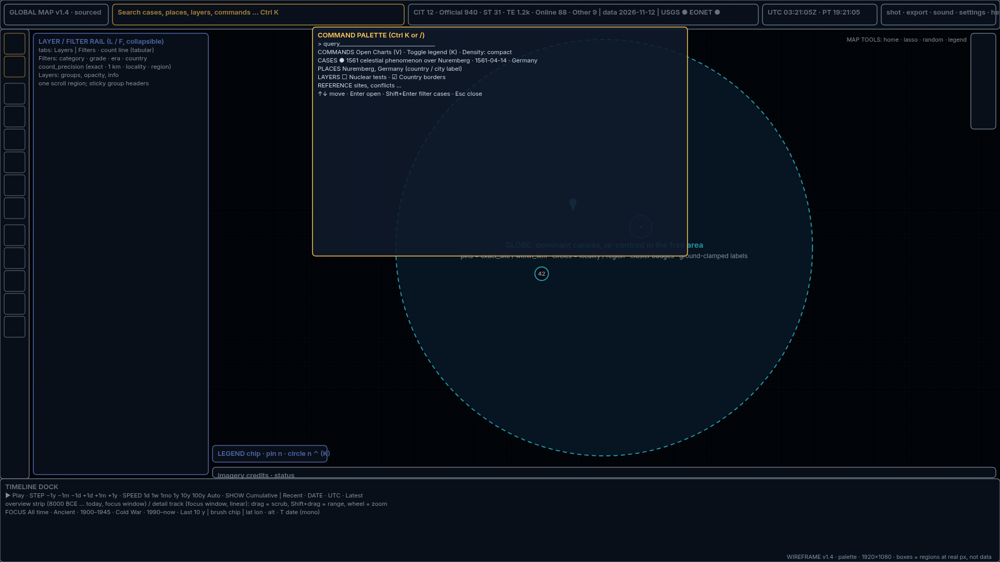
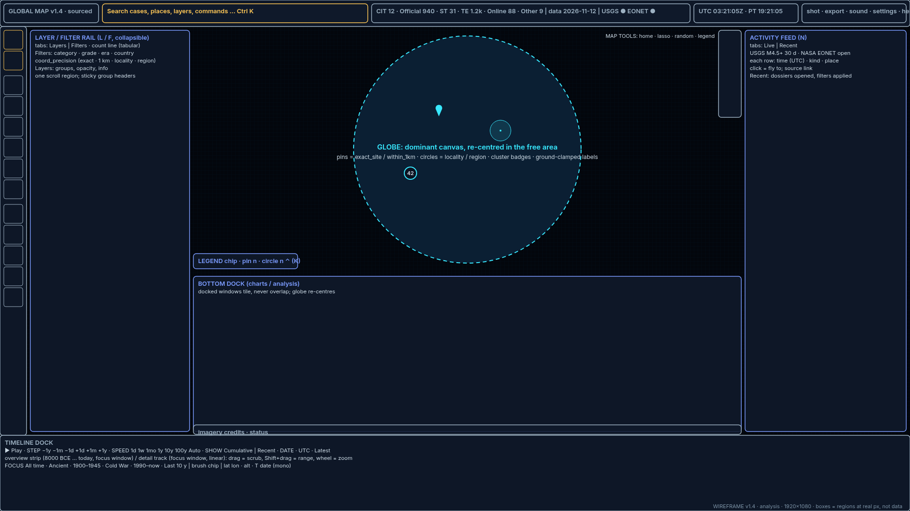
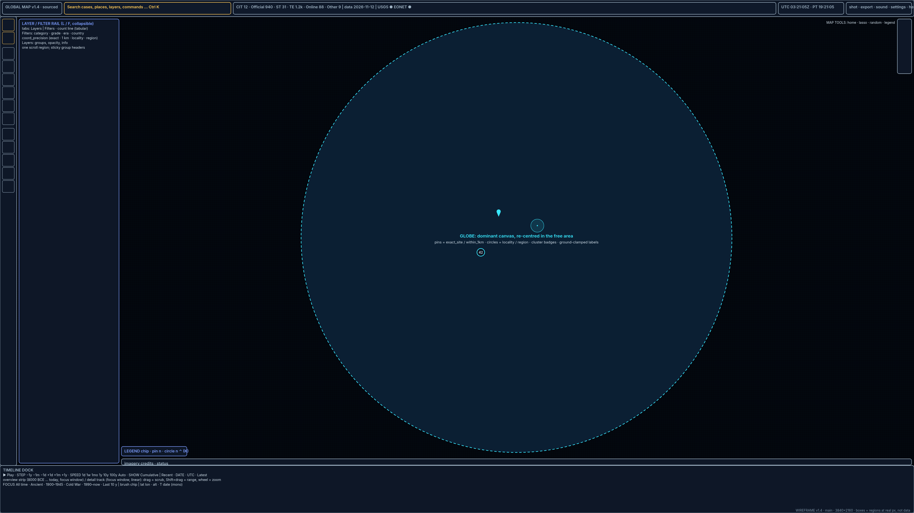
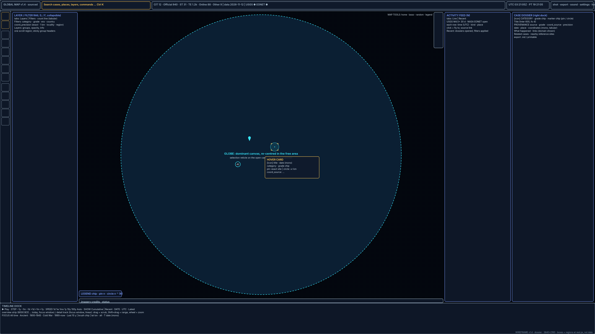

# v1.4 wireframes (low fidelity)

These wireframes are generated by `node scripts/design/wireframes_v14.mjs` from the same layout numbers as
`css/tokens.css` and `css/console.css`. Each box is a layout region drawn at its real pixel size. The text inside
the boxes is annotation, not data. The decision record is
[ADR 0004](../../../adr/0004-osint-console-information-architecture.md).

| Viewport  | State                                     | SVG                           | PNG                         |
| --------- | ----------------------------------------- | ----------------------------- | --------------------------- |
| 1280x800  | main: rail, legend, timeline              | [svg](1280x800_main.svg)      |       |
| 1280x800  | dossier, with the rail collapsed          | [svg](1280x800_dossier.svg)   |    |
| 1920x1080 | main                                      | [svg](1920x1080_main.svg)     |      |
| 1920x1080 | dossier, hover card and selection reticle | [svg](1920x1080_dossier.svg)  |   |
| 1920x1080 | command palette (Ctrl+K) over the console | [svg](1920x1080_palette.svg)  |   |
| 1920x1080 | analysis: activity feed and a bottom dock | [svg](1920x1080_analysis.svg) |  |
| 3840x2160 | main, at the 1.25x ladder                 | [svg](3840x2160_main.svg)     |      |
| 3840x2160 | dossier, feed and hover card              | [svg](3840x2160_dossier.svg)  |   |

## Region rules

- **Command bar, 56 px:** brand, omnibox, grade status strip, UTC and PT clocks, utilities.
- **Activity bar, 56 px:** 13 views in three groups. Each target is 40 px, on a 44 px pitch.
- **Rail:** 288 px below 1440 px wide, 320 px above. It collapses into the activity bar.
- **Right docks:** the dossier, 420 px, and the feed, 340 px. They tile inwards and never overlap.
- **Bottom dock:** charts and analysis, spanning the space between the side docks.
- **Legend:** bottom left of the free globe area. It moves above any bottom dock.
- **Map tools:** top right of the free globe area.
- **Timeline dock, 112 px:** the controls row and the histogram scrubber.
- **4K at DPR 1:** every size above is multiplied by 1.25.
